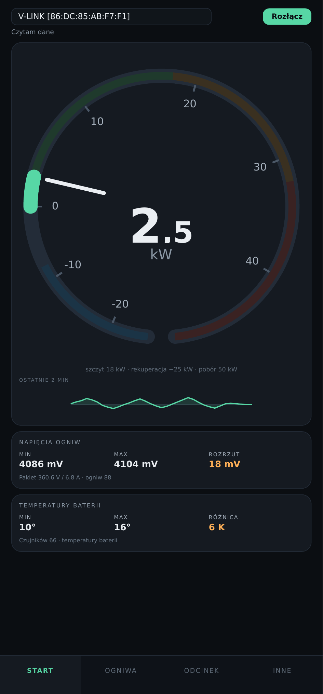

# MiEV Monitor

Aplikacja na telefon z Androidem, która pokazuje dane z elektrycznego auta
na żywo: moc, zapas energii w baterii, napięcia i temperatury ogniw oraz
historię jazd.

Sprawdzona na **Mitsubishi i-MiEV**. Peugeot iOn i Citroën C-Zero to ten sam
samochód w innej karoserii — aplikacja powinna działać, ale jeszcze tego nie testowano.
Jeśli masz te auta i chcesz pomóc, daj znać w zgłoszeniach.

---

## Co potrzebujesz

- telefon z Androidem 5.0 lub nowszym,
- adapter **ELM327 z Bluetooth** (taki, który wpina się w gniazdo diagnostyczne
  OBD-II pod deską rozdzielczą),
- włączony Bluetooth w telefonie.

## Instalacja

1. Wejdź na stronę wydań: **https://github.com/janas-karol/miev-monitor/releases/latest**
2. Pobierz plik `imiev-….apk`.
3. Otwórz go na telefonie i wybierz **Zainstaluj**.
   Jeśli system zapyta o zgodę na instalację z tego źródła (przeglądarka lub
   menedżer plików), zaznacz ją i wróć do instalacji.
4. Po instalacji otwórz aplikację **MiEV Monitor**.

> Aplikacja nie jest w Sklepie Play, dlatego instalujesz ją z pliku. Nie ma w niej
> dostępu do internetu i nic nie jest wysyłane poza telefon.

## Pierwsze połączenie z adapterem

Robisz to raz:

1. Włóż adapter ELM327 do gniazda OBD-II i włącz zapłon (lub tryb gotowości auta).
2. W ustawieniach **Bluetooth** telefonu wyszukaj adapter i sparuj go.
   Kod PIN to zwykle **1234** (czasem 0000).
3. Otwórz MiEV Monitor, wybierz adapter z listy i naciśnij **Połącz**.
4. Przy pierwszym uruchomieniu aplikacja poprosi o zgodę na Bluetooth i powiadomienia — zaakceptuj.

Gdy połączenie działa, u góry zobaczysz komunikat *„Czytam dane”*.

## Co pokazuje aplikacja

Dolne zakładki przełączają widoki:

| zakładka | co zobaczysz |
|---|---|
| **START** | zegar mocy (w lewo — odzysk energii, w prawo — pobór), pasek ostatnich 2 minut, napięcia ogniw, temperatury baterii |
| **OGNIWA** | napięcie każdego z 88 ogniw; najsłabsze pomarańczowe, najmocniejsze zielone |
| **ODCINEK** | bieżąca jazda (dystans, zużycie, czas) oraz historia poprzednich jazd |
| **INNE** | zasięg, przebieg, temperatura płynu grzewczego, klimatyzacja, eksport danych, ustawienia ekranu |

Zegar mocy: środek to aktualna moc w kW. Igła porusza się płynnie — przy skoku
z 2 na 20 kW przechodzi przez wartości pośrednie w około 0,3 s, jak obrotomierz.
Skala kończy się na −20 kW (odzysk) i 40 kW (pobór), bez kresek na samych końcach.
Zapas energii (SoC), prędkość i pobór ogrzewania znajdziesz w zakładce **INNE**.

### Jak działa odczyt w tle

- Aplikacja może czytać dane także przy **wyłączonym ekranie** — w pasku powiadomień
  widać wtedy stan i moc.
- Gdy połączenie się zerwie (np. auto zgaśnie), aplikacja sama próbuje ponownie co kilka sekund.
- Przycisk **Rozłącz** zatrzymuje odczyt.

### Ekran zawsze włączony

W zakładce **INNE** możesz włączyć przełącznik „Ekran zawsze włączony”, jeśli
telefon jest w uchwycie i chcesz widzieć dane cały czas.

## Zapis danych i eksport

- Jazda zapisuje się **sama**: zaczyna się, gdy auto ruszy, i kończy po 2 minutach
  stania albo po wyłączeniu auta. Nie musisz nic wciskać przed wyjściem z samochodu.
- Aplikacja zapisuje próbki na telefonie: co sekundę w czasie jazdy, co pół minuty
  na postoju. Każda próbka ma też napięcie najsłabszego i najmocniejszego ogniwa.
- Dane **zostają tylko w telefonie**.
- W zakładce **INNE** możesz wyeksportować zapis do pliku **CSV** (np. do arkusza kalkulacyjnego).
- Przycisk **Wyczyść bufor** kasuje zapisane próbki. Tej operacji nie da się cofnąć.

## Bezpieczeństwo i prywatność

- Aplikacja **nie ma dostępu do internetu** — nie może nic wysłać ani pobrać.
- Nie zbiera danych osobowych, nie ma reklam ani analityki.
- Używa tylko uprawnień potrzebnych do Bluetooth, powiadomień i pracy w tle.
- Jest **nieoficjalna** — nie jest powiązana z Mitsubishi Motors ani z PSA (Peugeot / Citroën).
  Nazwy aut podano wyłącznie, żeby wiadomo było, z jakimi modelami działa.

### Sprawdzenie pliku (dla zainteresowanych)

Na stronie wydania obok pliku APK są dwa pliki kontrolne:

- `SHA256SUMS-….txt` — suma kontrolna pliku APK. Jeśli Twoja suma się zgadza,
  plik jest dokładnie taki, jak opublikowany.
- `CERT-….txt` — odcisk certyfikatu, którym podpisano aplikację. Ten sam odcisk
  jest widoczny w zakładce **INNE**. Stały dla wszystkich wersji.

## Ograniczenia — przeczytaj przed jazdą

- **Bateria i zasięg:** zegar i dane są informacyjne. Nie zastępują wskaźników
  w aucie ani nie są podstawą do decyzji o bezpieczeństwie.
- **Jedno urządzenie naraz:** adapter łączy się tylko z jednym telefonem. Jeśli
  używasz go z inną aplikacją, najpierw się rozłącz.
- **Auto śpi:** gdy samochód jest wyłączony i nie wysyła danych, aplikacja nie ma
  co pokazać.
- **Oszczędzanie baterii:** niektóre telefony (Xiaomi, Samsung, Huawei) mogą zamykać
  aplikację w tle. Jeśli odczyt się przerywa, wyłącz dla MiEV Monitor
  optymalizację baterii w ustawieniach telefonu.
- **Uwaga na kierownicę:** nie patrz na ekran podczas prowadzenia. Ustaw telefon
  w uchwycie przed ruszeniem.

## Zgłaszanie problemów

Jeśli coś nie działa, zgłoś to na: **https://github.com/janas-karol/miev-monitor/issues**

Pomocne informacje: model telefonu, wersja Androida, numer wersji aplikacji
(w zakładce INNE), model adaptera i to, co się dzieje.

---

Dla programistów: kod, budowanie i szczegóły techniczne są w pliku
[`DEVELOPER.md`](DEVELOPER.md).
